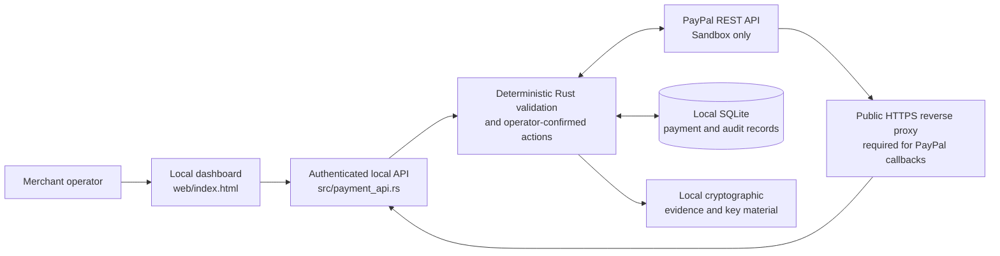

# Quantum Shield PayPal architecture

## Scope and verification boundary

This checkout is a merchant-side PayPal **Sandbox** integration. It is not an
approved live-money payment service. A recorded Sandbox checkout attempt ended
with `UNSUPPORTED_PAYEE_CURRENCY`; no completed PayPal payment was demonstrated.
Order creation/retrieval code, buyer approval, and explicit approval-before-capture
behavior are not evidence of a successful end-to-end payment. See the
[release status](docs/RELEASE_CANDIDATE_STATUS.md) for verified checks and
remaining blockers.

## Request and payment boundary

The dashboard is an operator interface. It does not decide whether a payment is
complete. Rust code validates the request and provider response. A buyer's
approval redirect does not authorize capture: an operator must review the order
and explicitly confirm capture. The service then checks PayPal's response and
reconciles the result before recording it. Refunds also require an explicit
operator request and provider-response checks.

The application binds to loopback by default and serves HTTP. It does not
terminate public HTTPS. PayPal webhook delivery therefore requires a publicly
reachable HTTPS endpoint in front of the service. That endpoint must preserve
PayPal's signature headers and raw request body when forwarding to
`POST /api/paypal/webhooks`.

## Components

- `web/index.html` provides the dashboard.
- `src/payment_api.rs` implements local routes, authentication, request limits,
  operator-confirmed capture/refund actions, and webhook handling.
- `src/paypal.rs` implements the PayPal REST client and provider-response checks.
- `src/payments.rs` persists local payment, capture, refund, and idempotency
  records in SQLite.
- `src/payment_security.rs` and related security modules provide local key,
  audit, and evidence operations.
- `src/payment_redteam/` runs deterministic synthetic security tests. The
  optional AI planner proposes test plans only; it cannot approve, capture,
  refund, contact PayPal, or verify a payment.

## Cryptography boundary

The implemented local components include ML-KEM-768 for key establishment,
ML-DSA-65 for evidence-related signatures, AES-256-GCM for authenticated
encryption, HKDF-SHA-256 for key derivation, and SHA-256 for hashing. These
operations concern local configuration, keys, audit, and evidence. They do not
provide post-quantum protection for PayPal, TLS, or external infrastructure.

## Local storage

Unless XDG paths are overridden, the launcher stores the SQLite database under
`~/.local/share/quantum-shield/payments/`. It stores the dashboard token, local
key material, encrypted Sandbox configuration, PID file, and private service log
under `~/.local/state/quantum-shield/`. Backups include payment records and
security-sensitive local state; keep them private and store them outside the
source tree. The [README](README.md) documents backup, restore, uninstall, and
recovery commands.

## Related guides

- [Beginner guide and operator commands](README.md)
- [Operations map](docs/OPERATIONS.md)
- [PayPal Sandbox deployment](docs/PAYPAL_DEPLOYMENT.md)
- [Security policy](SECURITY.md)
- [Release status](docs/RELEASE_CANDIDATE_STATUS.md)
