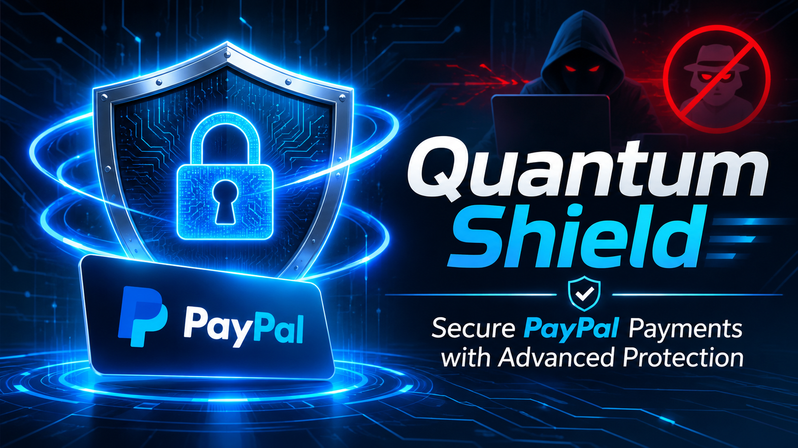

# Quantum Shield PayPal

<p align="center">
  
</p>

<p align="center">
  <strong>PayPal Sandbox payment workflow and security-testing application</strong><br>
  Rust backend · Browser dashboard · Payment workflow controls · Security regression tooling
</p>

> **Project status:** Development and security research. This repository is not a production-certified payment service. The artwork above is project branding and does not represent a certification, guarantee, or independently verified security result.

## Overview

Quantum Shield PayPal is a Rust-based application built to explore and demonstrate security-focused handling of PayPal Sandbox payment workflows. It combines a native application, a browser-based dashboard, configuration and operational resources, and security-testing utilities.

The project is intended to make payment activity and application behavior easier to inspect during controlled development and testing. Its scope includes:

- PayPal Sandbox payment workflow integration.
- A browser dashboard for interacting with the application and viewing backend-exposed status and events.
- Application-side validation and workflow controls.
- Security testing, attack-simulation support, and regression utilities.
- Audit and diagnostic resources.
- Linux execution and container build support.

The exact behavior available in a deployment depends on its configuration and external PayPal account capabilities. See **Known limitations** before relying on any result.

## How it works

### 1. Application startup

The Linux launcher starts the application runtime. The Rust backend provides application services, while the web dashboard provides the browser-facing interface.

Use the launcher output to confirm startup and identify the dashboard address. A dashboard loading successfully does not, by itself, prove that PayPal authentication or payment operations are working.

### 2. PayPal Sandbox payment lifecycle

The intended payment lifecycle has distinct stages:

1. Configure the application with PayPal Sandbox credentials.
2. Start the backend and open the dashboard.
3. Create a PayPal order.
4. Have the payer approve the order through PayPal.
5. Capture the approved order.
6. Inspect the capture response and the final application state.

**Order creation is not payment completion.** An order must be approved and successfully captured before the application can treat it as a completed payment. A dashboard event or local success message is not independent evidence of settlement by PayPal or a bank.

### 3. Security testing and visibility

The repository includes security-oriented implementation and test resources for examining application behavior under controlled scenarios. These tools can help demonstrate specific checks and record outcomes.

A passing test proves only the scenario covered by that test. It does not prove that all attack classes, payment fraud, authorization bypasses, or integration failures are prevented.

## Architecture and repository layout

| Path | Purpose |
| --- | --- |
| `src/` | Rust application implementation |
| `web/` | Browser dashboard assets |
| `scripts/` | Testing and operational scripts |
| `docs/` | Technical and project documentation |
| `deploy/` | Deployment resources |
| `third_party/` | Third-party components and notices |
| `Cargo.toml` | Rust package and dependency definitions |
| `Cargo.lock` | Locked dependency versions |
| `Dockerfile` | Container build instructions |
| `Run-Quantum-Shield.sh` | Linux application launcher |
| `.env.example` | Example configuration template |
| `SECURITY.md` | Security reporting guidance |
| `assets/` | Project artwork and visual assets |

## Requirements

- Linux for the supplied launcher.
- Rust toolchain and Cargo.
- Git.
- PayPal Developer Sandbox application and test accounts for external payment testing.
- Docker for the optional container build.

Check toolchain compatibility and dependency requirements in the repository before deployment.

## Build and run

Clone the repository:

```bash
git clone https://github.com/rohanreddimasu13-star/quantum-shield-paypal.git
cd quantum-shield-paypal
```

Build the application:

```bash
cargo build
```

Build an optimized release:

```bash
cargo build --release
```

Run on Linux:

```bash
chmod +x Run-Quantum-Shield.sh
./Run-Quantum-Shield.sh
```

Follow the launcher output for startup status and dashboard access instructions. Do not assume a service is healthy merely because the launcher process exists.

## Configuration and credential safety

Use `.env.example` as a reference for configuration fields and follow the application documentation for the effective configuration mechanism.

Use Sandbox credentials for development and testing. Never commit:

- PayPal client secrets or access tokens.
- Production API credentials.
- Private keys, signing secrets, or dashboard authentication tokens.
- Real customer information or payment records.
- Local configuration files containing actual secrets.

Keep real configuration outside source control. Review staged files before committing. The example configuration is a template, not a credential.

## Testing and code quality

Run the Rust test suite:

```bash
cargo test
```

Check formatting:

```bash
cargo fmt --all -- --check
```

Run Clippy:

```bash
cargo clippy --all-targets --all-features -- -D warnings
```

Check compilation:

```bash
cargo check
```

These commands evaluate local code and test coverage. They do not verify PayPal account eligibility, external checkout, payer approval, capture, webhook delivery, or production security.

## Docker

Build the container image:

```bash
docker build -t quantum-shield-paypal .
```

Review the Dockerfile and deployment resources before running a container. Supply secrets securely at runtime. Do not bake credentials into an image.

## Known limitations and verification boundaries

This section is important. A successful local build or test is not proof of a fully operational external payment service.

- **PayPal Sandbox dependency:** External operations depend on PayPal availability, application credentials, account configuration, merchant country, and supported currencies.
- **Checkout and currency restrictions:** Sandbox checkout can fail because of merchant country, payee currency, or account restrictions. An observed `UNSUPPORTED_PAYEE_CURRENCY` response is an integration limitation to investigate; local code cannot override PayPal account restrictions.
- **Approval and capture:** Order creation does not prove payer approval or successful capture. Test and verify each stage independently.
- **Dashboard visibility:** Displayed events and payment states represent application data. They are not independent confirmation of settlement by PayPal or a bank.
- **Webhooks:** End-to-end webhook behavior requires a reachable endpoint, correct configuration, and HTTPS where required.
- **Security coverage:** Included tests and demonstrations cover specific scenarios only. They cannot establish that all vulnerabilities or attack paths have been eliminated.
- **Deployment:** Linux is the intended launcher environment. Docker and other operating systems require validation in their target environments.
- **Compliance:** No PCI certification, financial regulatory approval, or production security certification is claimed.
- **Post-quantum security:** No post-quantum security guarantee is claimed by the project name or artwork.
- **Production use:** Do not process real customer payments without a separate security audit, integration validation, operational review, and applicable compliance work.

Treat this repository as a development and research project. Validate each integration in a controlled environment before relying on it.

## Recommended end-to-end validation

Before describing a deployment as operational, verify the following with actual Sandbox accounts:

1. The application starts and the dashboard connects to the backend.
2. Sandbox authentication succeeds.
3. Order creation returns a valid order identifier.
4. Payer approval completes successfully.
5. Capture returns a successful result.
6. The application records and displays the correct final state.
7. Invalid and unauthorized requests are rejected as expected.
8. Webhook signature verification and event handling work, if webhooks are enabled.
9. Logs do not expose credentials or sensitive payment information.

Record failures as failures. Do not substitute simulated results or dashboard screenshots for external payment confirmation.

## Responsible use and security reporting

Use this software only in environments and accounts you own or are authorized to test. Review [SECURITY.md](SECURITY.md) for security reporting guidance. Do not publish credentials, private exploit details, or customer data in public issues.

## Contributing

Contributions should explain the behavior changed and include relevant test results. Keep secrets and private configuration out of commits. Run formatting, tests, and lint checks before submitting changes.

## License and third-party notices

Review the license files and notices in `third_party/` before redistribution. Third-party components remain subject to their respective licenses and terms.
